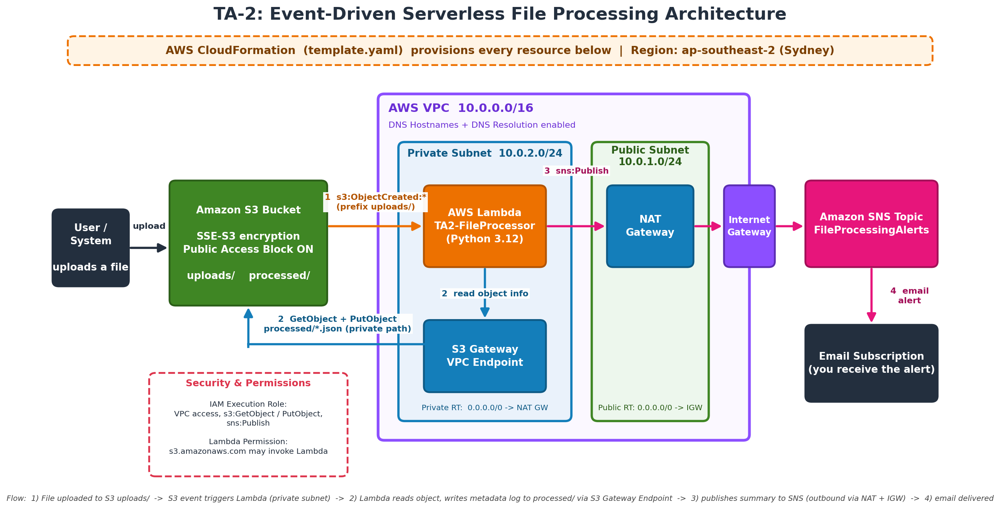

# Serverless-File-Processing-AWS-

# Event-Driven Serverless File Processing on AWS

An event-driven, serverless file processing architecture built using **AWS CloudFormation**, Amazon S3, AWS Lambda, Amazon VPC, and Amazon SNS.

## Architecture



## Workflow

1. A file is uploaded to an Amazon S3 bucket.
2. An S3 event triggers an AWS Lambda function deployed in a private subnet.
3. Lambda reads the uploaded object's details and writes processing metadata to S3 through an S3 Gateway VPC Endpoint.
4. Lambda publishes a processing summary to Amazon SNS through the NAT Gateway and Internet Gateway.
5. Amazon SNS sends an email notification to the subscribed recipient.

## AWS Services

- **AWS CloudFormation** — Infrastructure as Code (IaC).
- **Amazon S3** — Encrypted file storage with public access blocked.
- **AWS Lambda** — Event-driven processing using Python 3.12.
- **Amazon VPC** — Isolated network with public and private subnets.
- **NAT Gateway & Internet Gateway** — Outbound network connectivity.
- **S3 Gateway VPC Endpoint** — Private access to S3.
- **Amazon SNS** — Email notifications for processing events.
- **AWS IAM** — Execution roles and resource permissions.

## Key Features

- Automated processing triggered by S3 uploads.
- Serverless execution without managing servers.
- Private-subnet Lambda deployment.
- Encrypted storage and restricted public access.
- Automated email alerts through SNS.
- Infrastructure provisioned using CloudFormation.

## Repository Structure

```text
.
├── template.yaml
├── architecture-diagram.png
└── README.md
```

## Deployment

1. Deploy `template.yaml` using AWS CloudFormation in the **Asia Pacific (Sydney) — `ap-southeast-2`** region.
2. Confirm that the stack is created successfully.
3. Upload a test file to the S3 bucket.
4. Verify Lambda execution, the processed metadata output, and the SNS email notification.
5. Confirm the email subscription if prompted by AWS SNS.

**Note:** Update the template parameters, resource names, and email configuration as required for your environment.
